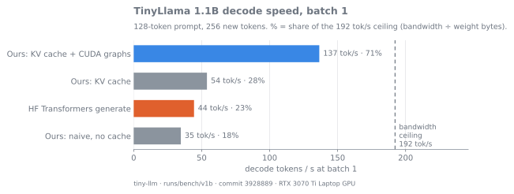
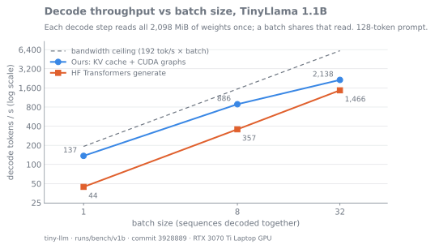
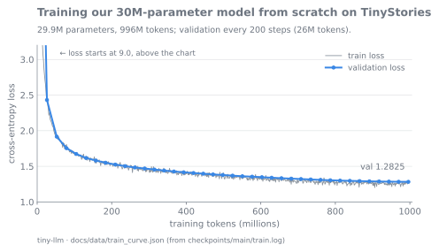
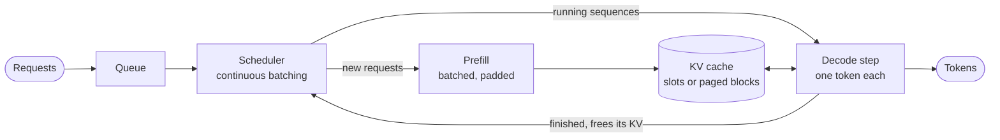

# tiny-llm

[](https://github.com/cooldip00/tiny-llm/actions/workflows/ci.yml)

A Llama-style LLM trained from scratch on one laptop GPU (RTX 3070 Ti Laptop, 8 GB), and an inference engine for it, benchmarked against the GPU's memory-bandwidth ceiling. Plain PyTorch, no inference libraries; Hugging Face Transformers appears only as a test reference and baseline.

**Highlights**
<!-- bench:highlights -->


- **TinyLlama 1.1B decodes at 127 tok/s at batch 1: 66% of the bandwidth ceiling, 2.9× HF `generate`** (KV cache + CUDA graphs).
- **Our engine's logits are bit-identical to HF Transformers** in bf16 on TinyLlama, prefill and cached decode.
- **Serving:** continuous batching gives 1.38× static batching. A paged KV cache fits 25 sequences where contiguous slots fit 8, for 1.62× the throughput in the same memory.
<!-- /bench:highlights -->
- **Training:** a 30M-parameter model on ~1B TinyStories tokens in 2 h 27 min at **56% MFU**.
- **HTTP server:** OpenAI-compatible, with streaming. Past capacity it rejects requests with a 429, so time to first token stays bounded, where vLLM's and llama.cpp's grow with the queue ([vs vLLM and llama.cpp](#results-vs-vllm-and-llamacpp)).

> Status: **v1-preview**. Still to come: a fused INT8 kernel, CUDA graphs for the paged engine, and an attention ablation (see [Roadmap](#roadmap)).

## Results: TinyLlama 1.1B inference

<!-- bench:tinyllama -->
Decode speed at batch 1 with a 128-token prompt, 256 new tokens, median of 5 runs. The ceiling is the measured bandwidth divided by the weight size: 423 GB/s ÷ 2,098 MiB = **192 tok/s per sequence**, because each decoded token has to read every weight once.

| Engine | tok/s | % of ceiling | ms / step |
|---|---|---|---|
| HF Transformers `generate` (bf16, SDPA) | 44 | 23% | 22.6 |
| Ours, naive (full forward per token) | 31 | 16% | 32.0 |
| Ours, KV cache | 48 | 25% | 20.8 |
| **Ours, KV cache + CUDA graphs** | **127** | **66%** | **7.9** |

- **Eager decode is host-bound.** At batch 1, HF and our eager engine take 22.6 and 20.8 ms per step (ours 20.5 ms at batch 32). The profiler shows the GPU idle 76% of an eager step, waiting for kernel launches. Capturing the decode step as a CUDA graph removes that overhead; the GPU is then idle 3% of the step.
- **Batching:** with graphs, 814 tok/s at batch 8 and 1,984 tok/s at batch 32 (HF: 359 and 1,440).
- **INT8 weights:** val loss +0.0010, 98.5% argmax agreement with bf16; decode is 0.75× bf16 at batch 1, 0.36× at batch 32. Slower, not faster: the weight is cast back to bf16 on every call, so each step moves more bytes, not fewer. A fused dequantize-and-multiply kernel fixes this; it's on the roadmap.
- **Correctness:** bf16 logits equal HF's bf16 logits exactly (`torch.equal`) at all 415 test positions. Every top-1 disagreement with fp32 is a near-tie (margin ≤ 0.019 logits).


<!-- /bench:tinyllama -->

Full tables from the same run, with GPU clocks and temperatures: [docs/RESULTS.md](docs/RESULTS.md). The method, caveats and the dated results of each step: [docs/INFERENCE.md](docs/INFERENCE.md).

## Results: serving

<!-- bench:serving -->
64 requests of mixed lengths (9,004 tokens to generate), median of 3 runs.

| Scheduler / cache | Setting | tok/s | vs baseline |
|---|---|---|---|
| Static batching (TinyLlama) | 8 slots | 189 | — |
| Continuous batching (TinyLlama) | 8 slots | 261 | 1.38× |
| Continuous batching + CUDA graphs (TinyLlama) | 8 slots | 581 | 2.23× vs eager continuous |
| Contiguous KV slots (30M model) | 64 MiB of KV, 8 sequences | 615 | — |
| Paged KV cache (30M model) | same 64 MiB, 25 sequences | 998 | 1.62× |

The paged cache stores KV in fixed-size blocks through a per-sequence block table, as in vLLM, so a sequence holds only the blocks it has filled. The share of reserved KV holding real tokens goes from 52% to 97%.
<!-- /bench:serving -->

## Results: vs vLLM and llama.cpp

TinyLlama 1.1B in bf16. All three engines serve the same OpenAI-compatible API to the same load-test client (`scripts/load_test.py`): 14-token prompts, 128 new tokens per request, Poisson arrivals, prefix caching off. "Within SLO" is the highest request rate with TTFT p95 ≤ 1 s. Full table, method and caveats: [docs/SERVING.md](docs/SERVING.md).

| Engine | Seats | One stream, tok/s (% of ceiling) | Within SLO | Saturation | Past saturation |
|---|---|---|---|---|---|
| **Ours** (continuous batching + CUDA graphs) | 8 | 112 (58%) | 4 req/s | ~5.5 req/s, ~710 tok/s | sheds load with 429s; the 32-place queue caps TTFT p95 at ~5.9 s |
| **Ours** | 32 | (same engine) | 8 req/s | ≥ 12.2 req/s, 1,555 tok/s | 429s; TTFT p95 2.6–2.9 s |
| vLLM 0.33 | 8 | 161 (84%) | 6 req/s | ~8.5 req/s, ~1,090 tok/s | queues without limit; TTFT p95 48 s at 16 req/s |
| vLLM 0.33, default | 256 | 161 (84%) | 32 req/s | ~34 req/s, ~4,370 tok/s | TTFT p95 21 s at 48 req/s |
| llama.cpp (bf16 GGUF) | 8 | 151 (79%) | 4 req/s | peaks at 5.4 req/s, then **falls** to 3.5 | TTFT p95 203 s at 16 req/s |


- **One stream:** vLLM is 1.44× faster and llama.cpp 1.35×. vLLM uses FlashAttention and fused kernels; we use PyTorch SDPA over padded slots and capture only the decode step as a graph.
- **Under load, seats set the capacity:** with 8 seats each we hold the same load as llama.cpp (4 req/s within SLO). vLLM's default admits 256 sequences into a paged KV pool, which is why it holds 32 req/s.
- **Past saturation:** we reject with 429s and keep latency bounded; vLLM and llama.cpp queue, and latency grows with the backlog.
- **Caveats:** one session on 2026-11-06, separate from the tables above, with the GPU thermally throttled in every run (84–87 °C), so differences under ~15% are ties. Our one-stream number here (112 tok/s) goes through the HTTP server with streaming; the 127 tok/s above is the engine alone.

## Results: training

| | |
|---|---|
| Model | 29.9M params: 8 layers, d_model 512, 8 heads, vocab 8,192 (our own BPE tokenizer) |
| Data | TinyStories, 996M tokens (~2.1 epochs) |
| Time | 2 h 27 min on the laptop GPU |
| Throughput | 115K tok/s, **56% MFU** (torch.compile: +57% over eager) |
| Final val loss | 1.2825 (train 1.280: no overfitting) |
| Export | Hugging Face Llama format (`scripts/export_hf.py`): HF Transformers' logits match ours to 1.4e-5, and the exported tokenizer gives identical ids on all 21,981 validation stories |



Sample after training, prompted with "Once upon a time": *"…a little girl named Lily. She was very curious… she found a shiny rock that looked like it was magic… she saw a butterfly that was also very shiny…"*

## How it works

The model block, the same layout as Llama. TinyLlama's weights load into it without any reshuffling ([docs/ARCHITECTURE.md](docs/ARCHITECTURE.md)):


A request's path through the serving engine:



- **KV cache:** each step computes attention only for the new token and reads the cached keys and values of earlier ones.
- **Continuous batching:** a finished sequence leaves the batch at once, and a waiting request takes its place, instead of the whole batch waiting for its longest member.
- **Paged KV:** when memory runs out, the newest sequence is preempted and recomputed later (vLLM's default policy).
- **CUDA graphs:** the whole decode step is recorded once and replayed, so the CPU launches one graph instead of hundreds of kernels.
- **HTTP server:** the engine runs in its own thread behind a FastAPI app that serves an OpenAI-compatible `/v1/completions`, streamed or not. When its queue is full it answers 429 instead of slowing everyone down; `/health`, `/ready` and Prometheus `/metrics` report its state ([docs/SERVING.md](docs/SERVING.md)).

## Repository layout

| Path | What's there |
|---|---|
| `src/tinyllm/model.py`, `attention/`, `config.py` | The transformer, swappable attention, model configs |
| `src/tinyllm/train.py`, `data.py`, `tokenizer.py`, `logger.py` | Training loop (bf16, torch.compile, MFU logging), data loading, BPE tokenizer, W&B logging |
| `src/tinyllm/generate.py`, `kv_cache.py` | Naive and KV-cached generation |
| `src/tinyllm/engine.py`, `paged_kv.py` | Static and continuous batching; paged KV cache with a block allocator |
| `src/tinyllm/cuda_graph.py` | Decode step captured as a CUDA graph |
| `src/tinyllm/quant.py` | INT8 weight-only quantization |
| `src/tinyllm/hf_llama.py`, `safetensors_io.py`, `logit_compare.py` | Loads Llama-format checkpoints (TinyLlama) and exports to them; compares logits with a reference model |
| `src/tinyllm/server.py`, `obs.py` | OpenAI-compatible HTTP server (streaming, 429s past capacity, timeouts); JSON logs and Prometheus metrics |
| `src/tinyllm/provenance.py`, `results.py`, `plots.py` | Records where each benchmark number came from (commit, versions, GPU clocks); renders the results tables and plots |
| `scripts/` | Data, tokenizer, benchmark, load-test (`load_test.py`) and HF export (`export_hf.py`) scripts |
| `tests/` | 301 tests: every optimized path is checked against the slow reference path |
| `docs/` | Write-ups with the method and dated results of each step: [ARCHITECTURE](docs/ARCHITECTURE.md), [INFERENCE](docs/INFERENCE.md), [SERVING](docs/SERVING.md). Generated tables: [RESULTS](docs/RESULTS.md). Also [HARDWARE](docs/HARDWARE.md), [SETUP](docs/SETUP.md), [RESEARCH](docs/RESEARCH.md) (the attention ablation plan) and [PRIOR_ART](docs/PRIOR_ART.md) (related projects). `docs/img/` holds the plots, drawn by `scripts/bench_all.py` from the runs and `docs/data/` |

## Reproduce

Linux or WSL2 with an NVIDIA GPU, and [uv](https://docs.astral.sh/uv/). Full setup, step by step: [docs/SETUP.md](docs/SETUP.md).

```bash
git clone https://github.com/cooldip00/tiny-llm.git && cd tiny-llm
uv sync                                          # exact versions from uv.lock (PyTorch 2.14.1, CUDA 13.0)
uv run pytest -q                                 # CUDA tests skip without a GPU

# Train the 30M model
uv run python scripts/download_data.py           # TinyStories
uv run python scripts/train_tokenizer.py         # BPE, 8,192 tokens
uv run python scripts/tokenize_data.py           # data/train.bin, data/val.bin
uv run python -m tinyllm.train --preset main --max_steps 7600

# Benchmark TinyLlama (weights download to the Hugging Face cache)
uv run python scripts/tinyllama_smoke.py
uv run python scripts/bench_generate.py --model tinyllama --engine kv-graph
uv run python scripts/bench_serving.py --model tinyllama
uv run python scripts/bench_quant.py --model tinyllama

# Serve TinyLlama over HTTP, then load-test it from a second terminal
uv run python -m tinyllm.server --model tinyllama --cuda-graph
uv run python scripts/load_test.py --rates 1,2,4 --power-mode performance

# Every results table: rerun all benchmarks (~1.5–2 h), then render docs/RESULTS.md and the README tables
uv run python scripts/bench_all.py --run --power-mode performance
uv run python scripts/bench_all.py               # re-render from the saved JSON, no GPU
```

CI runs the CPU test suite on every push. GPU benchmark numbers come from the laptop. The benchmark scripts save each result with the commit, library versions, and the GPU clocks and throttling seen during the run.

## Roadmap

- Fused INT8 dequantize + matrix-vector kernel in Triton
- CUDA graphs for the paged engine (the continuous engine has them)
- Attention ablation (MHA vs GQA vs MLA vs a Gated DeltaNet hybrid) at a fixed compute budget ([docs/RESEARCH.md](docs/RESEARCH.md))

## License

[MIT](LICENSE)
