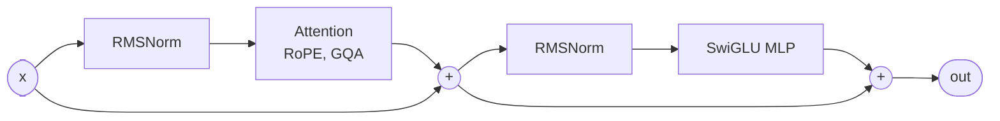

# tiny-llm

[](https://github.com/cooldip00/tiny-llm/actions/workflows/ci.yml)

A Llama-style LLM trained from scratch on one laptop GPU (RTX 3070 Ti Laptop, 8 GB), and an inference engine for it, benchmarked against the GPU's memory-bandwidth ceiling. Plain PyTorch, no inference libraries; Hugging Face Transformers appears only as a test reference and baseline.

**Highlights**
- **TinyLlama 1.1B decodes at 128 tok/s at batch 1: 67% of the bandwidth ceiling, 2.8× HF `generate`** (KV cache + CUDA graphs).
- **Our engine's logits are bit-identical to HF Transformers** in bf16 on TinyLlama, prefill and cached decode.
- **Serving:** continuous batching gives 1.37× static batching. A paged KV cache fits 25 sequences where contiguous slots fit 8, for 1.46× the throughput in the same memory.
- **Training:** a 30M-parameter model on ~1B TinyStories tokens in 2 h 27 min at **56% MFU**.

> Status: **v1-preview**. Still to come: comparisons with vLLM and llama.cpp, a fused INT8 kernel, and an attention ablation (see [Roadmap](#roadmap)).

## Results: TinyLlama 1.1B inference

Decode speed at batch 1 with a 128-token prompt, 256 new tokens, median of 5 runs. The ceiling is the measured bandwidth divided by the weight size: 423 GB/s ÷ 2,098 MiB = **192 tok/s per sequence**, because each decoded token has to read every weight once.

| Engine | tok/s | % of ceiling | ms / step |
|---|---|---|---|
| HF Transformers `generate` (bf16, SDPA) | 45 | 23% | 22.3 |
| Ours, naive (full forward per token) | 33 | 17% | 29.9 |
| Ours, KV cache | 45 | 23% | 22.3 |
| **Ours, KV cache + CUDA graphs** | **128** | **67%** | **7.8** |

- **Eager decode is host-bound.** HF and our eager engine both spend ~22 ms per step launching kernels, whatever the batch size. Capturing the decode step as a CUDA graph removes that overhead; the GPU is then idle only 3% of the step.
- **Batching:** with graphs, 851 tok/s at batch 8 and 2,083 tok/s at batch 32 (HF: 358 and 1,445).
- **INT8 weights:** quality is unchanged (val loss +0.0010, 98.5% argmax agreement with bf16), but decode is **slower**: 0.80× bf16 at batch 1, 0.54× at batch 32. The weight is cast back to bf16 on every call, so each step moves more bytes, not fewer. A fused dequantize-and-multiply kernel fixes this; it's on the roadmap.
- **Correctness:** bf16 logits equal HF's bf16 logits exactly (`torch.equal`) at all 415 test positions. Every top-1 disagreement with fp32 is a near-tie (margin < 0.02 logits).

Full tables, by batch size and prompt length, with the method and caveats: [docs/INFERENCE.md](docs/INFERENCE.md).

## Results: serving

64 requests of mixed lengths (9,004 tokens to generate), median of 3–5 runs.

| Scheduler / cache | Setting | tok/s | vs baseline |
|---|---|---|---|
| Static batching (TinyLlama) | 8 slots | 198 | — |
| Continuous batching (TinyLlama) | 8 slots | 272 | 1.37× |
| Continuous batching + CUDA graphs (TinyLlama) | 8 slots | 581 | 2.37× vs eager continuous in the same run (245) |
| Contiguous KV slots (30M model) | 64 MiB of KV, 8 sequences | 633 | — |
| Paged KV cache (30M model) | same 64 MiB, 25 sequences | 924 | 1.46× |

The paged cache stores KV in fixed-size blocks through a per-sequence block table, as in vLLM, so a sequence holds only the blocks it has filled. The share of reserved KV holding real tokens goes from 52% to 97%.

## Results: training

| | |
|---|---|
| Model | 29.9M params: 8 layers, d_model 512, 8 heads, vocab 8,192 (our own BPE tokenizer) |
| Data | TinyStories, 996M tokens (~2.1 epochs) |
| Time | 2 h 27 min on the laptop GPU |
| Throughput | 115K tok/s, **56% MFU** (torch.compile: +57% over eager) |
| Final val loss | 1.2825 (train 1.280: no overfitting) |

Sample after training, prompted with "Once upon a time": *"…a little girl named Lily. She was very curious… she found a shiny rock that looked like it was magic… she saw a butterfly that was also very shiny…"*

## How it works

The model block, the same layout as Llama. TinyLlama's weights load into it without any reshuffling ([docs/ARCHITECTURE.md](docs/ARCHITECTURE.md)):



A request's path through the serving engine:


- **KV cache:** each step computes attention only for the new token and reads the cached keys and values of earlier ones.
- **Continuous batching:** a finished sequence leaves the batch at once, and a waiting request takes its place, instead of the whole batch waiting for its longest member.
- **Paged KV:** when memory runs out, the newest sequence is preempted and recomputed later (vLLM's default policy).
- **CUDA graphs:** the whole decode step is recorded once and replayed, so the CPU launches one graph instead of hundreds of kernels.

## Repository layout

| Path | What's there |
|---|---|
| `src/tinyllm/model.py`, `attention/`, `config.py` | The transformer, swappable attention, model configs |
| `src/tinyllm/train.py`, `data.py`, `tokenizer.py` | Training loop (bf16, torch.compile, MFU logging), data loading, BPE tokenizer |
| `src/tinyllm/generate.py`, `kv_cache.py` | Naive and KV-cached generation |
| `src/tinyllm/engine.py`, `paged_kv.py` | Static and continuous batching; paged KV cache with a block allocator |
| `src/tinyllm/cuda_graph.py` | Decode step captured as a CUDA graph |
| `src/tinyllm/quant.py` | INT8 weight-only quantization |
| `src/tinyllm/hf_llama.py`, `safetensors_io.py` | Loads Llama-format checkpoints (TinyLlama) and exports to them |
| `scripts/` | Data, tokenizer and benchmark scripts |
| `tests/` | 221 tests: every optimized path is checked against the slow reference path |
| `docs/` | Architecture, inference results, hardware, setup log |

## Reproduce

Linux or WSL2 with an NVIDIA GPU, and [uv](https://docs.astral.sh/uv/). Full setup, step by step: [docs/SETUP.md](docs/SETUP.md).

```bash
git clone https://github.com/cooldip00/tiny-llm.git && cd tiny-llm
uv sync                                          # exact versions from uv.lock (PyTorch 2.14.1, CUDA 13.0)
uv run pytest -q                                 # CUDA tests skip without a GPU

# Train the 30M model
uv run python scripts/download_data.py           # TinyStories
uv run python scripts/train_tokenizer.py         # BPE, 8,192 tokens
uv run python scripts/tokenize_data.py           # data/train.bin, data/val.bin
uv run python -m tinyllm.train --preset main --max_steps 7600

# Benchmark TinyLlama (weights download to the Hugging Face cache)
uv run python scripts/tinyllama_smoke.py
uv run python scripts/bench_generate.py --model tinyllama --engine kv-graph
uv run python scripts/bench_serving.py --model tinyllama
uv run python scripts/bench_quant.py --model tinyllama
```

CI runs the CPU test suite on every push. GPU benchmark numbers come from the laptop. The benchmark scripts save each result with the commit, library versions, and the GPU clocks and throttling seen during the run.

## Roadmap

- Compare with vLLM and llama.cpp on the same GPU
- Fused INT8 dequantize + matrix-vector kernel in Triton
- CUDA graphs for the paged engine (the continuous engine has them)
- One command that regenerates every results table
- Attention ablation (MHA vs GQA vs MLA vs a Gated DeltaNet hybrid) at a fixed compute budget ([docs/RESEARCH.md](docs/RESEARCH.md))

## License

[MIT](LICENSE)
