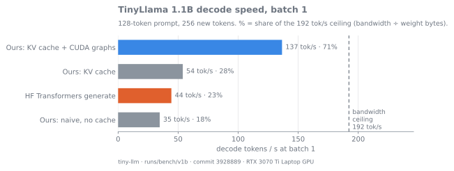
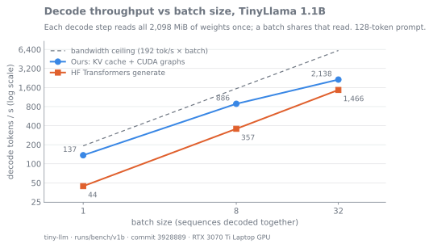
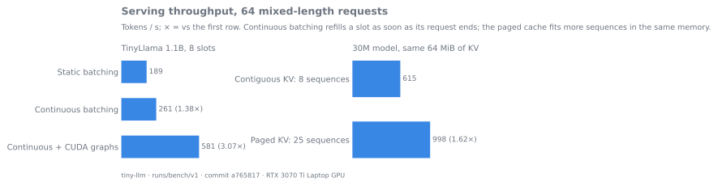
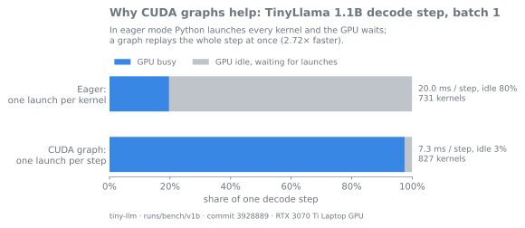

# Results

<!-- Generated by scripts/bench_all.py from runs/bench/v1b/. Do not edit by hand: change the script (src/tinyllm/results.py) and re-render. -->

Every number on this page comes from **one** run of `scripts/bench_all.py --run`: one commit, one session, one GPU job at a time, with a cool-down before each benchmark.

- **Run:** 2026-11-07T09:25:56+00:00 → 2026-11-07T11:09:51+00:00 UTC, commit `3928889`, NitroSense **performance-fans-max-room-fan-overhead**.
- **Machine:** NVIDIA GeForce RTX 3070 Ti Laptop GPU, driver 610.91, torch 2.14.1+cu130, CUDA 13.0.
- **How to read it:** ratios between rows of one table are the reliable result; they share a session and its heat. Absolute tok/s on this laptop moves 10–20% between sessions with temperature, so each table ends with its heat line. ⚠ marks a hardware slowdown, or a thermal slowdown with the busy clock median below 1,400 MHz.
- **Elsewhere:** dated results and the reasoning behind each step are in [INFERENCE.md](INFERENCE.md); ours vs vLLM vs llama.cpp under load (4.8a, rerun in 4.10c) is in [SERVING.md](SERVING.md).
- **Reproduce:** `uv run python scripts/bench_all.py` re-renders this page and the README tables from the saved JSON in seconds, with no GPU. `--run --power-mode <mode>` reruns everything (~1.5–2 h); `--only <bench>` reruns one benchmark.

**⚠ Throttling warnings:**
- 30m-serving: busy clock median 1155 MHz < 1400 -> consider scripts/bench_all.py --only 30m-serving
- tl-int8-graph: hw_slowdown, hw_thermal_slowdown -> consider scripts/bench_all.py --only tl-int8-graph

## TinyLlama 1.1B (bf16)

### Decode at batch 1

128-token prompt, 256 new tokens, median of 5 runs. Ceiling: 423 GB/s ÷ 2,098 MiB = **192 tok/s per sequence**.

| Engine | tok/s | % of ceiling | ms / step |
|---|---|---|---|
| HF Transformers `generate` (bf16, SDPA) | 44 | 23% | 22.5 |
| Ours, naive (full forward per token) | 35 | 18% | 28.8 |
| Ours, KV cache | 54 | 28% | 18.6 |
| **Ours, KV cache + CUDA graphs** | **137** | **71%** | **7.3** |

_Heat (busy SM clock median, peak GPU temperature, throttle reasons): hf: 1,875 MHz (min 1,365), 84 °C, sw_power_cap + sw_thermal_slowdown; naive: 1,530 MHz (min 1,395), 85 °C, sw_power_cap + sw_thermal_slowdown; kv: 1,875 MHz (min 1,185), 85 °C, sw_power_cap + sw_thermal_slowdown; kv-graph: 1,545 MHz (min 315), 84 °C, sw_thermal_slowdown._

### Decode by batch size and prompt length

| Engine | Batch | P=32 | P=128 | P=512 |
|---|---|---|---|---|
| HF Transformers `generate` (bf16, SDPA) | 1 | 44 (23%) | 44 (23%) | 44 (23%) |
| HF Transformers `generate` (bf16, SDPA) | 8 | 363 (24%) | 357 (23%) | 344 (22%) |
| HF Transformers `generate` (bf16, SDPA) | 32 | 1,426 (23%) | 1,466 (24%) | 1,459 (24%) |
| Ours, naive (full forward per token) | 1 | 46 (24%) | 35 (18%) | 17 (9%) |
| Ours, KV cache | 1 | 54 (28%) | 54 (28%) | 54 (28%) |
| Ours, KV cache | 8 | 437 (28%) | 436 (28%) | 431 (28%) |
| Ours, KV cache | 32 | 1,768 (29%) | 1,612 (26%) | 1,734 (28%) |
| Ours, KV cache + CUDA graphs | 1 | 142 (74%) | 137 (71%) | 120 (63%) |
| Ours, KV cache + CUDA graphs | 8 | 963 (63%) | 886 (58%) | 680 (44%) |
| Ours, KV cache + CUDA graphs | 32 | 2,522 (41%) | 2,138 (35%) | 1,275 (21%) |

Decode tok/s, with the % of the bandwidth ceiling at that batch size. — = skipped: prompt + new tokens exceed the context, which a KV cache can't slide.

### INT8 weights (per-row scales)

Two ways to run an int8 matmul: `int8` casts the weight back to bf16 on every call (plain PyTorch); `int8-triton` is our Triton kernel, which reads the int8 weight and dequantizes in registers (4.10b).

#### Eager decode (KV cache, no graphs)

| Batch | bf16 tok/s | int8 tok/s | int8 / bf16 |
|---|---|---|---|
| 1 | 54 | 37 | 0.68× |
| 8 | 432 | 291 | 0.67× |
| 32 | 1,722 | 1,153 | 0.67× |

- Weights: bf16 2,098 MiB, int8 1,113 MiB.
- Val loss: bf16 1.6284, int8 1.6294 (int8 +0.0010 vs bf16).
- Teacher-forced on bf16's greedy tokens: argmax agreement bf16 100.00%, int8 98.34% (median top-1 margin 2.12).
- Greedy rows identical to bf16: bf16 8/8, int8 0/8.

_Heat (busy SM clock median, peak GPU temperature, throttle reasons): tl-int8: 1,755 MHz (min 210), 86 °C, sw_power_cap + sw_thermal_slowdown._

#### With CUDA graphs: PyTorch path vs Triton kernel

Each variant is timed with only its own weights on the GPU.

| Batch | bf16 tok/s | int8 tok/s | int8-triton tok/s | int8 / bf16 | int8-triton / bf16 |
|---|---|---|---|---|---|
| 1 | 136 | 50 | 200 | 0.37× | 1.47× |
| 8 | 883 | 358 | 1,157 | 0.41× | 1.31× |
| 32 | 2,119 | 1,064 | 2,217 | 0.50× | 1.05× |

- Weights: bf16 2,098 MiB, int8 1,113 MiB, int8-triton 1,113 MiB.
- Val loss: bf16 1.6284, int8 1.6294, int8-triton 1.6294 (int8 +0.0010, int8-triton +0.0010 vs bf16).
- Teacher-forced on bf16's greedy tokens: argmax agreement bf16 100.00%, int8 98.34%, int8-triton 98.34% (median top-1 margin 2.12).
- Greedy rows identical to bf16: bf16 8/8, int8 0/8, int8-triton 0/8.

_Heat (busy SM clock median, peak GPU temperature, throttle reasons): tl-int8-graph: ⚠ 1,500 MHz (min 345), 86 °C, sw_power_cap + hw_slowdown + sw_thermal_slowdown + hw_thermal_slowdown._

#### The matmuls alone

| Rows (batch) | bf16 ms | PyTorch int8 ms | Triton int8 ms | Triton vs bf16 | Triton vs PyTorch int8 |
|---|---|---|---|---|---|
| 1 | 5.68 | 16.77 | 3.04 | 1.87× | 5.5× |
| 8 | 5.83 | 17.35 | 3.09 | 1.89× | 5.6× |
| 16 | 5.90 | 17.48 | 3.16 | 1.86× | 5.5× |
| 32 | 6.84 | 18.43 | 3.83 | 1.79× | 4.8× |
| 64 | 6.43 | 17.96 | 6.64 | 0.97× | 2.7× |

Time for every matmul of one decode step (the 155 Linears), replayed in CUDA graphs over weight copies larger than the L2 cache, so each call reads its weight from memory. At 1 row, a step must read 1,975 MiB of bf16 weights or 991 MiB of int8 weights and scales: bf16 runs at 86% of the measured 423 GB/s, the Triton kernel at 81%. PyTorch int8 casts each weight back to bf16 first, so it moves more bytes than bf16, not fewer.

_Heat (busy SM clock median, peak GPU temperature, throttle reasons): tl-int8-gemv: 1,688 MHz (min 1,140), 84 °C, sw_power_cap + sw_thermal_slowdown._

### Fused RMSNorm + residual add (Triton, 4.10a)

| Batch | PyTorch norm tok/s | Triton norm tok/s | Triton vs PyTorch | ms per step |
|---|---|---|---|---|
| 1 | 128 | 135 | 1.06× | 7.82 → 7.38 |
| 8 | 828 | 883 | 1.07× | 9.66 → 9.06 |
| 32 | 2,028 | 2,138 | 1.05× | 15.78 → 14.97 |

KV cache + CUDA graphs, the two norms alternating at each batch size. At batch 1 a decode step runs 1,164 GPU ops with the PyTorch norm and 827 with the Triton kernels (GPU busy 7.73 → 7.22 ms per step). Residual add + norm alone: one row takes 16.0 µs in PyTorch and 2.1 µs in Triton; 4,096 rows run at 97% of the measured 423 GB/s. Greedy rows identical to the PyTorch norm: 1/8; teacher-forced argmax agreement 99.28%.

_Heat (busy SM clock median, peak GPU temperature, throttle reasons): tl-rmsnorm: 1,575 MHz (min 375), 84 °C, sw_power_cap + sw_thermal_slowdown._

### Serving: static vs continuous batching, with and without CUDA graphs

| Engine | Slots | tok/s | vs | Latency mean / p95 (s) | TTFT mean / p95 (s) | KV MiB | KV claimed in use | Peak active | Preempt | Same as solo |
|---|---|---|---|---|---|---|---|---|---|---|
| static | 8 | 218 | — | 20.84 / 39.86 | 17.87 / 36.13 | 86 | — | — | 0 | 32/64 |
| continuous | 8 | 299 | 1.37× static | 14.06 / 25.94 | 10.82 / 22.96 | 352 | 13% | 8 | 0 | 30/64 |
| cont+graph | 8 | 637 | 2.13× continuous | 6.71 / 12.32 | 5.19 / 10.95 | 352 | 13% | 8 | 0 | 30/64 |
| static | 32 | 746 | — | 6.56 / 11.80 | 3.58 / 6.60 | 349 | — | — | 0 | 28/64 |
| continuous | 32 | 780 | 1.05× static | 5.61 / 10.00 | 2.02 / 5.26 | 1408 | 14% | 32 | 0 | 26/64 |
| cont+graph | 32 | 1,017 | 1.30× continuous | 4.51 / 7.71 | 1.71 / 4.31 | 1408 | 14% | 32 | 0 | 26/64 |

64 requests, all queued at t=0 (seed 0); median-wall run of 3. "Same as solo": requests whose tokens equal solo `generate()`; bf16 near-ties flip some, so it is reported, not asserted.

_Heat (busy SM clock median, peak GPU temperature, throttle reasons): tl-serving: 1,875 MHz (min 1,425), 85 °C, sw_power_cap + sw_thermal_slowdown._

### Logits vs HF Transformers

Ours (bf16) and HF Transformers (bf16, eager) against an fp32 HF reference, on the same prompts.

| Phase | Positions | Ours == HF bf16 (`torch.equal`) | Max abs Δ, ours vs HF | Top-1 vs fp32: ours | Top-1 vs fp32: HF | Our margin at each fp32 flip |
|---|---|---|---|---|---|---|
| prefill, triton norm | 151 | no | 0.344 | 100.00% | 100.00% | none |
| decode, triton norm | 264 | no | 0.281 | 98.86% | 98.86% | 0.019, 0.043, 0.007 |
| prefill, torch norm | 151 | yes | 0 | 100.00% | 100.00% | none |
| decode, torch norm | 264 | yes | 0 | 98.86% | 98.86% | 0.002, 0.019, 0.007 |

Greedy, 5 prompts × 64 tokens: ours equals HF bf16 on 2/5. First divergence from the fp32 greedy text, ours / HF: never / never; never / token 43; token 24 / token 24; never / never; token 32 / token 32.

_Heat (busy SM clock median, peak GPU temperature, throttle reasons): tl-logits: 1,770 MHz (min 210), 64 °C, sw_power_cap._

## Our 30M model (bf16 weights)

### Decode by batch size and prompt length

256 new tokens, median of 5 runs. Ceiling: 423 GB/s ÷ 57 MiB = **7,075 tok/s per sequence**.

| Engine | Batch | P=32 | P=128 | P=512 |
|---|---|---|---|---|
| Naive | 1 | 136 (2%) | 156 (2%) | 155 (2%) ‡ |
| Naive | 8 | 1,232 (2%) | 1,059 (2%) | 604 (1%) ‡ |
| Naive | 32 | 1,870 (1%) | 1,187 (1%) | 596 (0%) ‡ |
| KV cache | 1 | 149 (2%) | 139 (2%) | — |
| KV cache | 8 | 1,065 (2%) | 1,133 (2%) | — |
| KV cache | 32 | 4,509 (2%) | 4,657 (2%) | — |
| KV + CUDA graphs | 1 | 1,269 (18%) | 1,157 (16%) | — |
| KV + CUDA graphs | 8 | 8,501 (15%) | 7,770 (14%) | — |
| KV + CUDA graphs | 32 | 22,977 (10%) | 20,750 (9%) | — |

Decode tok/s, with the % of the bandwidth ceiling at that batch size. — = skipped: prompt + new tokens exceed the context, which a KV cache can't slide. ‡ = prompt + new tokens exceed the context, so naive slides its window.

_Heat (busy SM clock median, peak GPU temperature, throttle reasons): naive: 1,485 MHz (min 1,005), 83 °C, sw_power_cap + sw_thermal_slowdown; kv: 975 MHz (min 480), 64 °C, no throttling; kv-graph: 1,875 MHz (min 1,410), 78 °C, sw_power_cap._

### Serving: static, continuous, CUDA graphs, paged KV

Paged rows: `paged/<block size>`, all within the 8-slot contiguous cache's KV memory.

| Engine | Slots | tok/s | vs | Latency mean / p95 (s) | TTFT mean / p95 (s) | KV MiB | KV claimed in use | Peak active | Preempt | Same as solo |
|---|---|---|---|---|---|---|---|---|---|---|
| static | 8 | 468 | — | 9.67 / 18.56 | 8.25 / 16.78 | 63 | — | — | 0 | 40/64 |
| continuous | 8 | 638 | 1.36× static | 6.57 / 12.14 | 5.05 / 10.75 | 64 | 52% | 8 | 0 | 40/64 |
| cont+graph | 8 | 3,090 | 4.84× continuous | 1.41 / 2.60 | 1.10 / 2.32 | 64 | 52% | 8 | 0 | 40/64 |
| static | 32 | 1,700 | — | 2.80 / 5.16 | 1.37 / 2.70 | 254 | — | — | 0 | 37/64 |
| continuous | 32 | 1,782 | 1.05× static | 2.44 / 4.34 | 0.76 / 2.30 | 256 | 57% | 32 | 0 | 36/64 |
| cont+graph | 32 | 6,216 | 3.49× continuous | 0.78 / 1.29 | 0.26 / 0.80 | 256 | 57% | 32 | 0 | 36/64 |
| paged/16 | 8 | 590 | 0.93× continuous 8 (same KV memory) | 7.10 / 13.15 | 5.45 / 11.63 | 64 | 97% | 8 | 0 | 40/64 |
| paged/16 | 32 | 1,049 | 1.64× continuous 8 (same KV memory) | 3.95 / 7.39 | 2.12 / 5.29 | 64 | 97% | 25 | 42 | 40/64 |
| paged/8 | 32 | 1,032 | 1.62× continuous 8 (same KV memory) | 4.00 / 7.57 | 2.11 / 5.49 | 64 | 99% | 26 | 48 | 37/64 |
| paged/32 | 32 | 1,011 | 1.59× continuous 8 (same KV memory) | 4.14 / 7.72 | 2.29 / 5.48 | 64 | 94% | 25 | 40 | 38/64 |
| paged/16 | 64 | 1,052 | 1.65× continuous 8 (same KV memory) | 3.92 / 7.36 | 2.09 / 5.27 | 64 | 97% | 25 | 42 | 38/64 |

64 requests, all queued at t=0 (seed 0); median-wall run of 3. "Same as solo": requests whose tokens equal solo `generate()`; bf16 near-ties flip some, so it is reported, not asserted.

_Heat (busy SM clock median, peak GPU temperature, throttle reasons): 30m-serving: ⚠ 1,155 MHz (min 570), 84 °C, sw_power_cap + sw_thermal_slowdown._

### INT8 weights

| Batch | fp32 tok/s | bf16 tok/s | int8 tok/s | bf16 / fp32 | int8 / fp32 |
|---|---|---|---|---|---|
| 1 | 118 | 163 | 100 | 1.38× | 0.85× |
| 8 | 905 | 1,247 | 766 | 1.38× | 0.85× |
| 32 | 3,498 | 4,938 | 3,092 | 1.41× | 0.88× |

- Weights: fp32 114 MiB, bf16 57 MiB, int8 45 MiB.
- Val loss: fp32 1.2825, bf16 1.2825, int8 1.2826 (bf16 +0.0000, int8 +0.0001 vs fp32).
- Teacher-forced on fp32's greedy tokens: argmax agreement fp32 99.26%, bf16 99.22%, int8 99.17% (median top-1 margin 1.71).
- Greedy rows identical to fp32: fp32 32/32, bf16 9/32, int8 1/32.

_Heat (busy SM clock median, peak GPU temperature, throttle reasons): 30m-int8: 1,050 MHz (min 465), 66 °C, sw_power_cap._

## Decode-step profile (batch 1, 128-token context)

| Model (B=1) | Decode step | ms / step | Host issue ms | GPU busy ms | GPU idle | tok/s | % of ceiling |
|---|---|---|---|---|---|---|---|
| TinyLlama 1.1B | eager | 19.95 | 18.99 | 6.73 | 80% | 50 | 26% |
| TinyLlama 1.1B | graph | 7.34 | 0.67 | 7.26 | 3% | 136 | 71% |
| 30M | eager | 6.65 | 6.44 | 3.15 | 72% | 150 | 2% |
| 30M | graph | 0.93 | 0.26 | 0.91 | 8% | 1,070 | 15% |

_Heat (busy SM clock median, peak GPU temperature, throttle reasons): TinyLlama: 1,875 MHz (min 255), 76 °C, no throttling; 30M: 1,410 MHz (min 270), 61 °C, no throttling._

